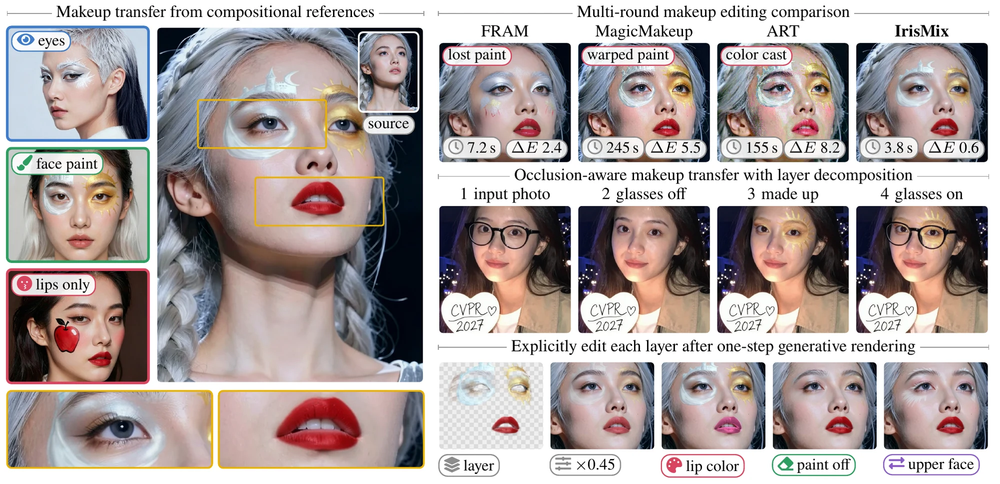

<h1 align="center">IrisMix: Compositional Makeup Transfer and Editing<br>with Layered Diffusion</h1>

<p align="center">
  <a href="https://ming053l.github.io/">Chia-Ming Lee</a><sup>1,2</sup>&nbsp;&nbsp;
  <a href="https://mingching.github.io/">Ming-Ching Chang</a><sup>1</sup>&nbsp;&nbsp;
  <a href="https://scholar.google.com/citations?user=gMBvzGoAAAAJ&hl=en">Xin Li</a><sup>1</sup>&nbsp;&nbsp;
  <a href="https://basiclab.lab.nycu.edu.tw/">Hong-Han Shuai</a><sup>2</sup>&nbsp;&nbsp;
  <a href="https://yulunalexliu.github.io/">Yu-Lun Liu</a><sup>2</sup>&nbsp;&nbsp;
  <a href="https://cchsu.info/">Chih-Chung Hsu</a><sup>2</sup>
</p>

<p align="center">
  <sup>1</sup>University at Albany, SUNY&nbsp;&nbsp;&nbsp;<sup>2</sup>National Yang Ming Chiao Tung University
</p>

<p align="center">
  <a href="https://ming053l.github.io/IrisMix/"></a>
  
  
</p>

<p align="center">
  
</p>

> [!NOTE]
> **Code release:** code and weights will be released in this repository. Watch or star it to get notified.
> In the meantime, results, interactive examples and the research video are on the [project page](https://ming053l.github.io/IrisMix/).

## Abstract

Makeup design involves combining references, refining individual parts, and revisiting earlier choices. Diffusion-based makeup transfer produces realistic results, but its flattened outputs keep no explicit makeup, so subsequent revisions may require another generation pass that can alter identity and accepted regions. IrisMix couples explicit makeup layers for editing with diffusion rendering for appearance adaptation. One diffusion transformer with dual LoRAs decomposes each reference into a bare face and reusable color and coverage layers, and, after the layers of one or more references are composed on the source face, renders the composite so that it fits the facial geometry and scene illumination. Occluders are layers too, so glasses can be lifted off before transfer and restored afterwards, and the rendered result is again an editable layer: color, strength and selected regions can be adjusted without resampling. To train the decomposer and the renderer, we construct **LayerBeauty**, which pairs portraits with explicit compositing layers for everyday and artistic makeup. IrisMix decomposes and renders a full look in under 4 s, and over repeated edits it drifts far less in regions that were never edited.

## Overview

<p align="center">
  
</p>

One frozen MMDiT carries two LoRAs. The decomposer splits each reference photo into its bare face and a makeup layer (coverage α, color F) in one step, trained with harmonize / decompose cycle consistency. The layers of the chosen parts are warped to the source face and composed, and the renderer turns the composite into a natural photo in one more step, trained by self-transfer. The rendered makeup is recovered as a layer in closed form, so strength, recoloring and part toggles are direct layer edits that need no network call.

## Citation

If you find our work useful for your research, please consider citing us:

```bibtex
@misc{lee2026irismix,
  title  = {{IrisMix}: Compositional Makeup Transfer and Editing with Layered Diffusion},
  author = {Lee, Chia-Ming and Chang, Ming-Ching and Li, Xin and
            Shuai, Hong-Han and Liu, Yu-Lun and Hsu, Chih-Chung},
  year   = {2026},
  note   = {Preprint}
}
```
