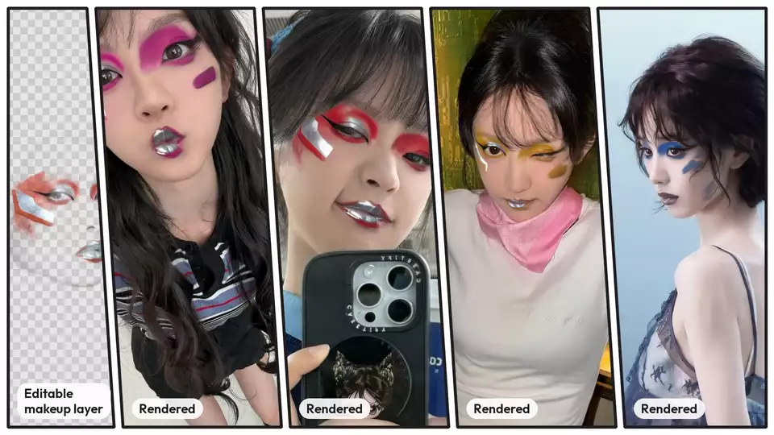
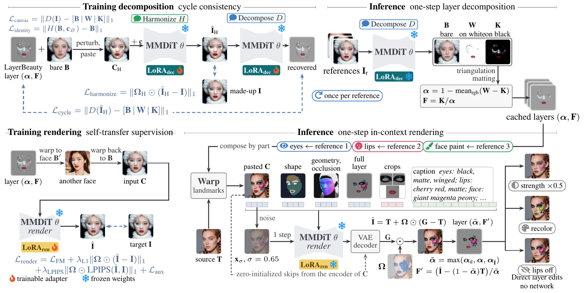
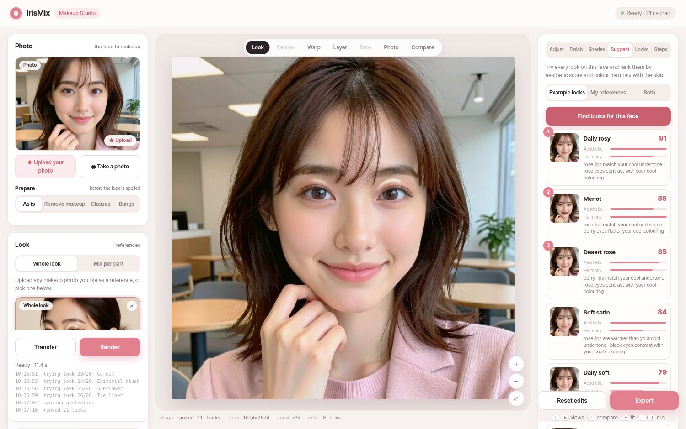
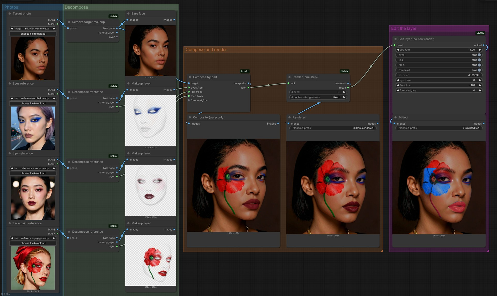

<h1 align="center">IrisMix: Compositional Makeup Transfer and Editing<br>with Layered Diffusion</h1>

<p align="center">
  <a href="https://ming053l.github.io/">Chia-Ming Lee</a><sup>1,2</sup>&nbsp;&nbsp;
  <a href="https://mingching.github.io/">Ming-Ching Chang</a><sup>1</sup>&nbsp;&nbsp;
  <a href="https://scholar.google.com/citations?user=gMBvzGoAAAAJ&hl=en">Xin Li</a><sup>1</sup>&nbsp;&nbsp;
  <a href="https://basiclab.lab.nycu.edu.tw/">Hong-Han Shuai</a><sup>2</sup>&nbsp;&nbsp;
  <a href="https://yulunalexliu.github.io/">Yu-Lun Liu</a><sup>2</sup>&nbsp;&nbsp;
  <a href="https://cchsu.info/">Chih-Chung Hsu</a><sup>2</sup>
</p>

<p align="center">
  <sup>1</sup>University at Albany, SUNY&nbsp;&nbsp;&nbsp;<sup>2</sup>National Yang Ming Chiao Tung University
</p>

<p align="center">
  <a href="https://ming053l.github.io/IrisMix/"></a>
  
  <a href="https://huggingface.co/ming0531/IrisMix"></a>
  <a href="https://huggingface.co/datasets/ming0531/LayerBeauty"></a>
</p>

<p align="center">
  <a href="https://ming053l.github.io/images/web/irismix-teaser.mp4"></a>
  <br><sub>Click the animation for the full research video.</sub>
</p>

<p align="center">
  
</p>

This repository contains the inference code of IrisMix, the interactive viewer IrisMix Studio, ComfyUI nodes and a loader
for the LayerBeauty dataset; the weights are on Hugging Face. The training code is not part of this release. The project
page is served from this repository as well.

- ✅ Inference code and weights
- ✅ IrisMix Studio (browser interface)
- ✅ ComfyUI nodes and an example workflow
- ✅ LayerBeauty dataset and loader
- ⬜ arXiv paper

## Abstract

Makeup design involves combining references, refining individual parts, and revisiting earlier choices. Diffusion-based makeup transfer produces realistic results, but its flattened outputs keep no explicit makeup, so subsequent revisions may require another generation pass that can alter identity and accepted regions. IrisMix couples explicit makeup layers for editing with diffusion rendering for appearance adaptation. One diffusion transformer with dual LoRAs decomposes each reference into a bare face and reusable color and coverage layers, and, after the layers of one or more references are composed on the source face, renders the composite so that it fits the facial geometry and scene illumination. Occluders are layers too, so glasses can be lifted off before transfer and restored afterwards, and the rendered result is again an editable layer: color, strength and selected regions can be adjusted without resampling. To train the decomposer and the renderer, we construct **LayerBeauty**, which pairs portraits with explicit compositing layers for everyday and artistic makeup. IrisMix decomposes and renders a full look in under 4 s, and over repeated edits it drifts far less in regions that were never edited.

## Overview

<p align="center">
  
</p>

One frozen MMDiT carries two LoRAs. The decomposer splits each reference photo into its bare face and a makeup layer (coverage α, color F) in one step, trained with harmonize / decompose cycle consistency. The layers of the chosen parts are warped to the source face and composed, and the renderer turns the composite into a natural photo in one more step, trained by self-transfer. The rendered makeup is recovered as a layer in closed form, so strength, recoloring and part toggles are direct layer edits that need no network call.

## Setup

```bash
git clone https://github.com/ming053l/IrisMix.git && cd IrisMix
conda create -n irismix python=3.10 -y && conda activate irismix
pip install torch==2.7.1 --index-url https://download.pytorch.org/whl/cu128
pip install -r requirements.txt
huggingface-cli download ming0531/IrisMix --local-dir weights   # optional: missing weights are downloaded on first use
```

`pip install -e .` also installs the commands `irismix-infer` (= `python scripts/infer.py`) and `irismix-studio`
(= `python scripts/viewer.py`); a non-editable install (`pip install .`) keeps the weights in `~/.cache/irismix/weights`.

| File | Component |
|---|---|
| `irismix_lora_init.safetensors` | rank-32 LoRA modules on FLUX.2 [klein] 4B (initialization of both models) |
| `irismix_decomposer.safetensors` | decomposition LoRA and skip convolutions |
| `irismix_renderer.safetensors` | rendering LoRA (EMA) and skip convolutions |

These are the models reported in the paper. File sizes and sha256 are in [weights/README.md](weights/README.md);
`IRISMIX_WEIGHTS` or `--decomposer / --renderer / --lora_init` point elsewhere. FLUX.2 [klein] 4B (Apache-2.0) is
downloaded on first use (`IRISMIX_BASE_MODEL` for a local copy). The face parser (`jonathandinu/face-parsing`, pinned
revision, non-commercial, see [NOTICE](NOTICE)) and the MediaPipe face landmarker are cached in `~/.cache/irismix`
(`IRISMIX_CACHE`). One GPU with about 16 GB free is enough: the decomposer and the renderer share one base pipeline, and
the text encoder stays on the CPU.

## Command line and Python

```bash
# one reference for the whole look
python scripts/infer.py --src source.jpg --ref reference.jpg --out out/

# a look composed from several references (each optional; one reference may supply several parts)
python scripts/infer.py --src source.jpg --eyes ref_a.jpg --lips ref_b.jpg --face ref_c.jpg --forehead ref_c.jpg --out out/

# closed-form edits of the recovered layer
python scripts/infer.py --src source.jpg --ref reference.jpg --out out/ --strength 0.6 --recolour lips=#b0303a --hue eyes=40 --off forehead
```

Outputs: `result.png` (render), `paste.png` (warp-only composite after the transfer rules), `layer.npz` (α̃ and F′,
float16) and `layer.png` (RGBA), plus `edited.png` when an edit is requested. `--warp_only` stops after the transfer
rules. The sampler of the paper is the default (`irismix/config.py`): σ 0.65, one Euler step, edit region dilated by 2 px,
seed 0, bf16. The Python API is in `irismix/pipeline.py` (`decompose`, `paste`, `look_item`, `apply_edits`); see
`irismix/infer.py` for the complete flow.

## IrisMix Studio

<p align="center"></p>

```bash
python scripts/viewer.py --port 7007          # then open http://localhost:7007 (ssh -L 7007:localhost:7007 for a remote GPU)
```

A browser interface for the whole method, served from the GPU machine by a standard-library HTTP server. Upload a photo or
pick one of the examples, use one reference for the whole look or mix references per part, remove existing makeup, lift
glasses and bangs, render, and then change strength, color, hue, softness and lip finish in the browser. The interface is
in English, Traditional Chinese, Japanese and Korean. Options, the optional VLM stylist and tests:
[docs/viewer.md](docs/viewer.md).

## ComfyUI

<p align="center"></p>

Four nodes (Decompose, Compose by Part, Render and Edit Layer) and an example workflow. Installation and usage:
[comfyui/README.md](comfyui/README.md).

## LayerBeauty

[ming0531/LayerBeauty](https://huggingface.co/datasets/ming0531/LayerBeauty) pairs made-up faces with their bare faces
and explicit makeup layers: 13,273 creative looks built makeup-first and 4,794 daily looks built bare-first, all of
synthetic people. It is stored as Parquet with the configs `creative_scene` and `daily_scene`; each row has `madeup`,
`bare`, `layer` (RGB color, A coverage), part weights and metadata. [scripts/layerbeauty.py](scripts/layerbeauty.py)
streams rows from the Hub (`pip install datasets`) or reads items kept as files, and returns the made-up image, the bare
face, coverage, color and the five part weights.

## Tests

```bash
pip install pytest
python -m pytest tests -q                         # CPU: smoke test, layer algebra, Studio API, failure paths
python -m pytest tests/test_viewer_gpu.py -q -s   # GPU: renders, occluders, re-make-up, recommendation
```

## Citation

```bibtex
@misc{lee2026irismix,
  title  = {{IrisMix}: Compositional Makeup Transfer and Editing with Layered Diffusion},
  author = {Lee, Chia-Ming and Chang, Ming-Ching and Li, Xin and
            Shuai, Hong-Han and Liu, Yu-Lun and Hsu, Chih-Chung},
  year   = {2026},
  note   = {Preprint},
  url    = {https://ming053l.github.io/IrisMix/}
}
```

## License

Code: Apache-2.0 ([LICENSE](LICENSE)). Weights and LayerBeauty: CC BY-NC 4.0, non-commercial use only. Third-party
models: [NOTICE](NOTICE). The example images in `assets/examples` and `tests/data` are from LayerBeauty (synthetic people)
and follow its license.

## Responsible use

IrisMix edits faces. Use it only on photos of people who agreed to it, do not use it to deceive, and label edited images
where that matters.

## Acknowledgements

IrisMix builds on [FLUX.2 [klein]](https://huggingface.co/black-forest-labs/FLUX.2-klein-4B),
[MediaPipe Face Landmarker](https://ai.google.dev/edge/mediapipe/solutions/vision/face_landmarker),
[face-parsing](https://huggingface.co/jonathandinu/face-parsing) (SegFormer), the
[LAION aesthetic predictor](https://github.com/christophschuhmann/improved-aesthetic-predictor),
[ComfyUI](https://github.com/comfyanonymous/ComfyUI) and, for the optional stylist,
[Qwen3-VL](https://huggingface.co/Qwen/Qwen3-VL-4B-Instruct-FP8).
