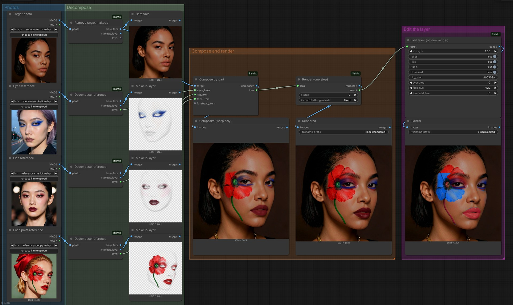

# IrisMix nodes for ComfyUI

<p align="center"></p>

| Node | Inputs | Outputs |
|---|---|---|
| IrisMix Decompose | `photo` | `bare_face`, `makeup_layer` (preview over a checkerboard), `layer` |
| IrisMix Compose by Part | `target` photo; optional `eyes_from`, `lips_from`, `face_from`, `forehead_from` (layers) | `composite` (warp only), `look` |
| IrisMix Render | `look`, `seed` | `rendered`, `result` (the render as a layer over the target) |
| IrisMix Edit Layer | `result`, strength, part switches, lip color (#RRGGBB), hue per part | `edited` |

Edit Layer runs in closed form on the CPU and does not call the network. To make up a face that already wears makeup,
connect the `bare_face` output of a Decompose node to the `target` input of Compose, as in the example workflow.

## Install

```bash
git clone https://github.com/ming053l/IrisMix.git ~/IrisMix
ln -s ~/IrisMix/comfyui /path/to/ComfyUI/custom_nodes/ComfyUI-IrisMix   # link only this folder into custom_nodes
pip install -r ~/IrisMix/requirements.txt       # into the Python environment that runs ComfyUI
```

The nodes import the `irismix` package from the repository root, one level above this folder. Download the weights into
`~/IrisMix/weights` as described in the [main README](../README.md#setup), or set `IRISMIX_WEIGHTS`. FLUX.2 [klein] 4B,
the face parser and the landmark model are downloaded on first use.

## Example workflow

Copy the four example images into ComfyUI's input folder and load the workflow:

```bash
cp ~/IrisMix/assets/examples/{source-warm,reference-cobalt,reference-merlot,reference-poppy}.webp /path/to/ComfyUI/input/
```

Then drag `workflows/irismix_workflow.json` onto the canvas and press Run. `workflows/irismix_workflow_api.json` is the same
graph in API format (`POST /prompt`), and `workflows/make_workflow.py` writes both files.

The decomposer and the renderer share one FLUX.2 [klein] base pipeline and the text encoder stays on the CPU, so the
example runs on a GPU with about 16 GB free (about 25 s, most of it loading the models).
